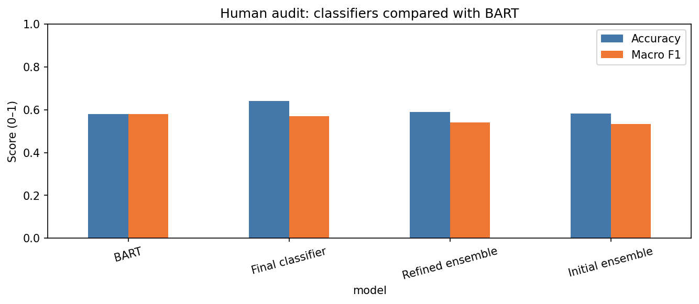

# Sri Lankan News, Classified

**Ensemble learning for automated topic classification**

[Presentation](https://www.canva.com/design/DAHbgyUrZkI/OCqJ3tTEl25WYWq05fOtzg/edit) · [Preprocessing notebook](News_Preprocessing.ipynb) · [Training notebook](News_Training.ipynb) · [Results report](results/ML_Assignment_Results_Report.md) · [Source dataset](https://github.com/nuuuwan/lk_news)

## Why this project

Manually assigning topics to thousands of news stories takes time, and overlapping subjects can lead annotators to different decisions. We explored whether confident machine labels and cautious ensemble screening could provide a repeatable training workflow for Sri Lankan news. The goal is to support topic triage and identify uncertain cases for review, rather than claim that automatic agreement guarantees a correct label.

## News sources and preparation

The corpus comes from [nuuuwan/lk_news](https://github.com/nuuuwan/lk_news), using the [pinned archive snapshot](https://github.com/nuuuwan/lk_news/tree/8a14da7c922131fcf6adc4f70726cabcb1c518d8). The earlier archive contained 136,451 articles across English, Sinhala and Tamil; 51,590 were English, and earlier English screening retained 50,528. These are background archive counts: the final classification experiment uses a fixed **10,000-article English input**.

English coverage includes Daily Mirror, Daily FT, Ada Derana, The Island, EconomyNext, News1st, Colombo Telegraph and DBS Jeyaraj. Headlines, article bodies and source metadata support preparation and analysis. Inclusion does not establish a publisher’s factual accuracy or reliability.

The final input covers 13 topics: business/economy, crime/justice, education, entertainment, health/healthcare, information technology, politics/governance, sport, telecommunications, tourism/travel, transport, weather/environment/disasters, and other.

### Keeping related articles together

We normalized content, joined exact article/body matches, and detected lexical near-duplicates using full-body word trigrams with cosine similarity of at least 0.90. Connected matches formed **9,628 content groups**. Groups stayed within a single partition to reduce content leakage; semantic paraphrases below the detection threshold may remain.

| Partition | Articles | Purpose |
|---|---:|---|
| Training | 6,197 | Seed training and candidate refinement |
| Validation | 1,550 | Screening-rule and final-model selection |
| Test | 1,941 | Frozen final-model evaluation |
| Audit quarantine | 312 | 300 representatives plus 12 group companions |

Audit groups were reserved before revised fits and excluded from training, validation and test. Grouped folds also kept detected related content together during stacking.

## How we implemented classification

### 1. BART provides initial labels

We used [facebook/bart-large-mnli](https://huggingface.co/facebook/bart-large-mnli) for zero-shot topic scoring on each headline and the first 200 body words. A training article became a seed when its top BART score was at least **0.70** and its top-two margin was at least **0.20**.

This produced **3,156 confident seeds** and **3,041 uncertain training candidates**. These are machine-labeled seeds, not independently verified ground truth. BART topic scores are not calibrated correctness probabilities.

### 2. TF-IDF turns full articles into model inputs

The downstream classifiers use the **headline and full article body**. TF-IDF represents words and word pairs with up to 12,000 features, minimum document frequency 2 and sublinear term frequency. Vocabulary and IDF are fitted on the permitted training data, including separately within each out-of-fold training fold.

### 3. Five approaches are compared

| Approach | Role in the experiment |
|---|---|
| Logistic regression | Learns linear topic coefficients from TF-IDF features |
| Random forest | Averages class probabilities from 100 trees |
| XGBoost | Builds 80 boosted trees |
| LinearSVC | Standalone linear classifier using raw decision scores |
| Stacking | Logistic-regression meta-model using 39 out-of-fold probabilities: three base models × 13 topics |

The stack combines logistic regression, random forest and XGBoost. **LinearSVC stays outside the stack.** Up to three stratified group folds generate the out-of-fold probabilities used to train the meta-model.

### 4. Ensemble agreement screens uncertain labels

We screened confidence, margin and voting rules using validation results. The selected rule required a stack probability of at least **0.95**, a top-two margin of at least **0.30**, and unanimous agreement from the three base models. Per-topic additions were capped at that topic’s seed count.

The rule accepted **315 of 3,041 candidates (10.36%)**, expanding training from **3,156 to 3,471 articles**. The other **2,726** candidates remained excluded. Agreement is a consistency check among models sharing BART supervision; it does not verify correctness.

| Training stage | What changed |
|---|---|
| Initial | Confident BART seeds only |
| Baseline refined | Original screening rule; 533 accepted additions |
| Selected refined | Validation-screened rule; 315 accepted additions |
| Weighted refined | Selected additions receive a training weight of 0.5 |

### 5. Validation selects the final predictor

| Model | Initial | Baseline refined | Selected refined | Weighted refined |
|---|---:|---:|---:|---:|
| **LinearSVC** | 0.6272 | 0.6384 | **0.6422** | 0.6421 |
| Logistic regression | 0.6104 | 0.6148 | 0.6158 | 0.6134 |
| Random forest | 0.5025 | 0.5423 | 0.5476 | 0.5363 |
| Stacking | 0.5749 | 0.5843 | 0.5844 | 0.5953 |
| XGBoost | 0.5571 | 0.5564 | 0.5541 | 0.5631 |

*Macro F1 against BART pseudo-labels, validation n = 1,550.*

Four of five models improved from initial to selected-refined training; XGBoost declined slightly. Selected-refined **LinearSVC** won validation and was frozen for final evaluation. The stack screens candidate labels; LinearSVC makes the final predictions.

## Results and interpretation

### Frozen test evaluation

On **1,941 test articles**, the selected LinearSVC achieved:

| Measure | Result |
|---|---:|
| Agreement with BART labels | **77.13%** |
| Macro F1 | **0.6019** |
| Weighted F1 | **0.7618** |

These measure agreement with the machine-label reference, not independently verified accuracy. Performance was uneven: sport achieved F1 **0.9455**, while information technology and telecommunications had F1 **0** on their test samples. Overall scores therefore hide substantial minority-topic weaknesses.

### Provisional 300-article audit

| Model | Agreement with supplied audit labels | Macro F1 |
|---|---:|---:|
| BART | 174/300 · 58.0% | **0.5802** |
| Frozen LinearSVC | **192/300 · 64.0%** | 0.5693 |

LinearSVC matched more supplied labels, while BART had higher macro F1. The refined stack corrected 33 BART disagreements and introduced 30, a net gain of three against this label set.

The supplied audit was described by the user as reviewed, but its retained annotation notes record AI assistance and request independent review. **No independently human-verified subset or second annotator is documented.** These results are descriptive comparisons against provisional labels, not an independent human benchmark. The audit did not determine the selected model.

The [three audit heatmaps](results/figures) distinguish supplied labels versus LinearSVC, supplied labels versus BART, and LinearSVC versus BART. The last measures agreement between model predictions, not correctness.

## What we learned

Cautious pseudo-label refinement increased the training set by about 10% and modestly improved most validation models. More pseudo-labeled data did not help every model, and stacking did not outperform the selected standalone classifier. The project demonstrates a functioning news-triage workflow, with clear reasons to retain human review.

Shared teacher errors, topic overlap, limited rare-category examples, uncalibrated scores and one fixed split constrain the evidence. Earlier test results had already been viewed, and earlier development may have exposed some audit articles. Independent annotation and evaluation on new sources or later periods are needed before stronger operational claims.

## Project resources

- [Presentation — Canva](https://www.canva.com/design/DAHbgyUrZkI/OCqJ3tTEl25WYWq05fOtzg/edit) — narrative, architecture and experimental findings; access follows the deck’s sharing settings.
- [Preprocessing notebook](News_Preprocessing.ipynb) and [training notebook](News_Training.ipynb) — implementation and saved outputs.
- [Results report](results/ML_Assignment_Results_Report.md) and [selected exports](results) — comparison tables, audit evidence and figures.
- [Frozen selection](results/frozen_selection.json) and [artifact provenance](results/artifact_manifest.json) — dataset hash, configuration and source records.
- [Upstream dataset](https://github.com/nuuuwan/lk_news) and [BART model](https://huggingface.co/facebook/bart-large-mnli) — source corpus and zero-shot teacher.

Implemented with pandas, NumPy, scikit-learn and XGBoost.
