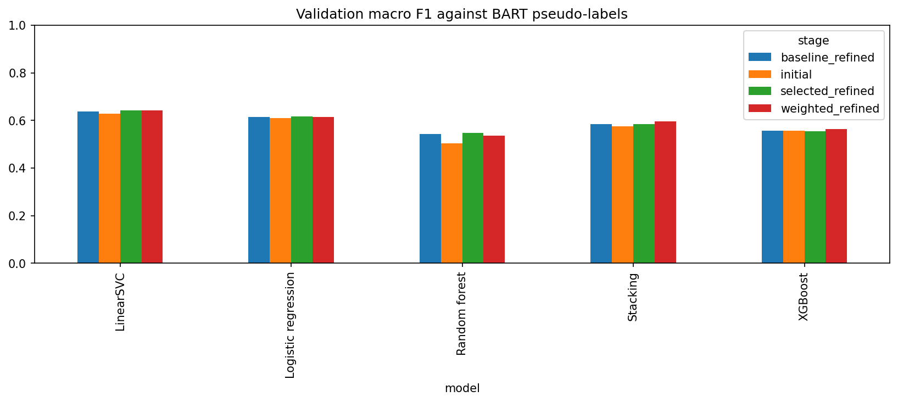
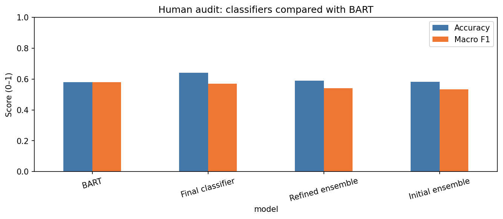
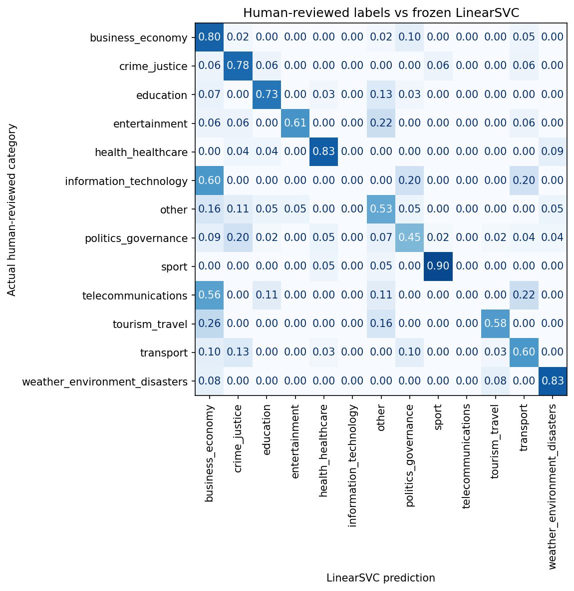
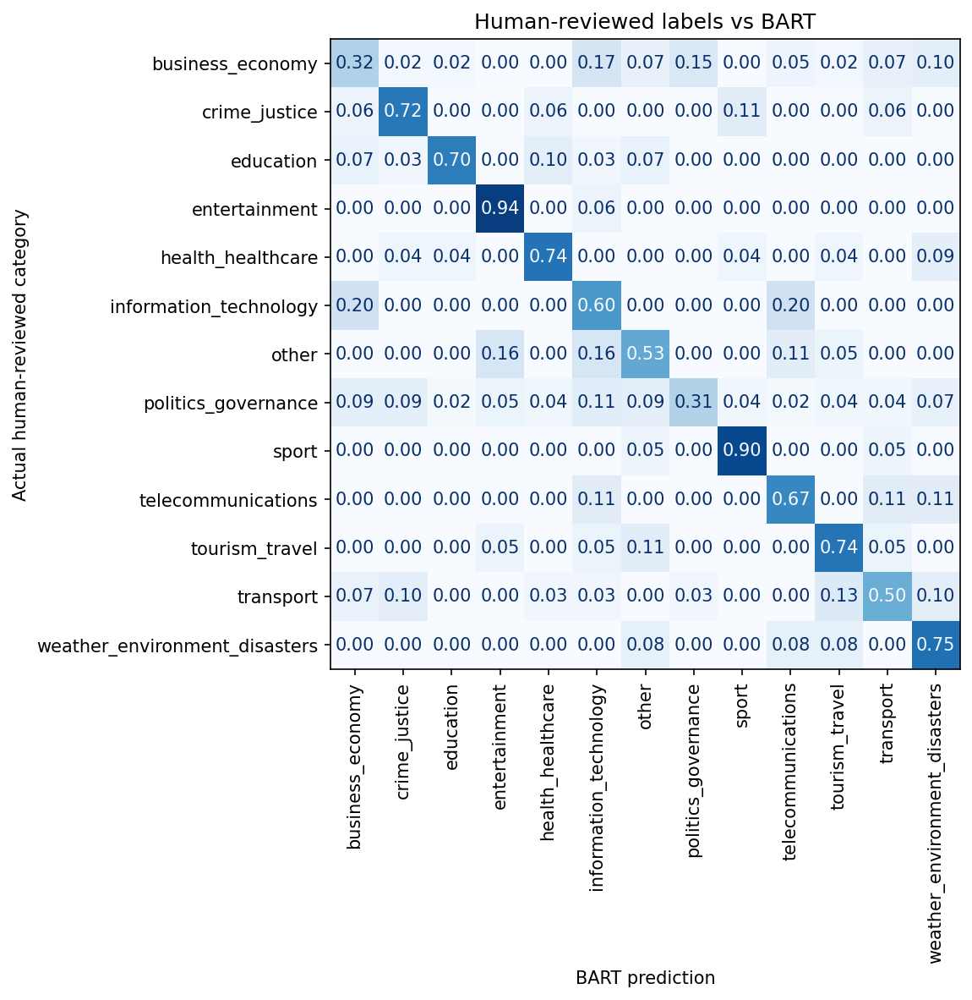
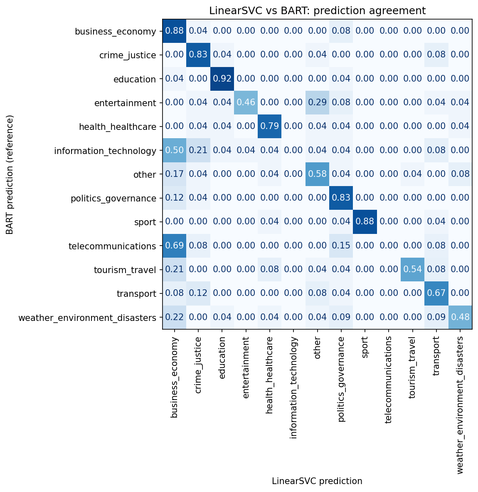

# ML Assignment Results Report

## Objective
Reduce large-scale manual labeling through a largely automated news classification pipeline.

## Dataset overview
10,000 source rows, 10,000 usable unique article IDs, 9,628 detected content groups and 13 categories. SHA256: `d18e3a42036021cdf0eb8608e2a81a43da469f5703cadacc93e38629913639ef`. {'train': 6197, 'test': 1941, 'validation': 1550, 'audit_quarantine': 312}

## Methodology
Audit groups reserved before all revised fits; approximately 64/16/20 group partitions for remaining data. Fold-specific TF-IDF, confident BART seeds, LR/RF/XGBoost/LinearSVC and group OOF stacking. No Apache Spark. Original baseline preserved separately; prior test/development exposure is disclosed.

## Initial model training
  stage               model         reference    n  fit_seconds  inference_seconds_all_models  accuracy  macro_f1  weighted_f1  precision   recall
initial Logistic regression BART pseudo-label 1550    33.284985                      6.345373  0.765161  0.610442     0.756708   0.706453 0.590996
initial       Random forest BART pseudo-label 1550    26.631940                      6.345373  0.729677  0.502477     0.705788   0.591700 0.472923
initial             XGBoost BART pseudo-label 1550   397.030731                      6.345373  0.741935  0.557143     0.734755   0.581267 0.560110
initial           LinearSVC BART pseudo-label 1550     5.187801                      6.345373  0.767742  0.627217     0.759174   0.728237 0.602291
initial            Stacking BART pseudo-label 1550   463.136743                      6.345373  0.692903  0.574916     0.731427   0.570328 0.603265

## Pseudo-label refinement
{"confidence": 0.95, "margin": 0.3, "agreement": "unanimous", "cap_multiplier": 1.0}
Added 315 articles; unresolved 2,726. Screening covers LR/SVC for 12 rules; full fits cover original, selected and weighted rules.

## Final model comparison
           stage               model         reference    n  fit_seconds  inference_seconds_all_models  accuracy  macro_f1  weighted_f1  precision   recall
         initial Logistic regression BART pseudo-label 1550    33.284985                      6.345373  0.765161  0.610442     0.756708   0.706453 0.590996
         initial       Random forest BART pseudo-label 1550    26.631940                      6.345373  0.729677  0.502477     0.705788   0.591700 0.472923
         initial             XGBoost BART pseudo-label 1550   397.030731                      6.345373  0.741935  0.557143     0.734755   0.581267 0.560110
         initial           LinearSVC BART pseudo-label 1550     5.187801                      6.345373  0.767742  0.627217     0.759174   0.728237 0.602291
         initial            Stacking BART pseudo-label 1550   463.136743                      6.345373  0.692903  0.574916     0.731427   0.570328 0.603265
baseline_refined Logistic regression BART pseudo-label 1550    32.733655                      5.429594  0.763871  0.614797     0.756822   0.703647 0.598579
baseline_refined       Random forest BART pseudo-label 1550    33.859286                      5.429594  0.740645  0.542260     0.721596   0.648605 0.511122
baseline_refined             XGBoost BART pseudo-label 1550   466.843833                      5.429594  0.739355  0.556411     0.732650   0.582102 0.557492
baseline_refined           LinearSVC BART pseudo-label 1550     7.357171                      5.429594  0.767097  0.638425     0.760077   0.723276 0.619043
baseline_refined            Stacking BART pseudo-label 1550   541.848396                      5.429594  0.712903  0.584345     0.747028   0.587085 0.615832
selected_refined Logistic regression BART pseudo-label 1550    33.293218                      6.106264  0.765161  0.615812     0.758016   0.705543 0.599540
selected_refined       Random forest BART pseudo-label 1550    31.804525                      6.106264  0.739355  0.547641     0.720603   0.648857 0.517542
selected_refined             XGBoost BART pseudo-label 1550   429.880314                      6.106264  0.732258  0.554118     0.725594   0.580513 0.554744
selected_refined           LinearSVC BART pseudo-label 1550     6.053799                      6.106264  0.770968  0.642161     0.763708   0.728344 0.621929
selected_refined            Stacking BART pseudo-label 1550   501.834838                      6.106264  0.701935  0.584435     0.737342   0.581405 0.613999
weighted_refined Logistic regression BART pseudo-label 1550    31.637779                      6.589671  0.765806  0.613377     0.758128   0.705901 0.594699
weighted_refined       Random forest BART pseudo-label 1550    31.176051                      6.589671  0.724516  0.536267     0.705796   0.652003 0.500640
weighted_refined             XGBoost BART pseudo-label 1550   419.069981                      6.589671  0.740000  0.563061     0.732647   0.588202 0.564295
weighted_refined           LinearSVC BART pseudo-label 1550     7.647478                      6.589671  0.771613  0.642094     0.764272   0.729011 0.620882
weighted_refined            Stacking BART pseudo-label 1550   490.300246                      6.589671  0.710323  0.595284     0.745637   0.594395 0.625314

## Coverage versus reliability
 confidence  margin agreement  accepted  bart_agreement  mean_votes  mean_score
       0.85     0.2 unanimous       715        0.804196    3.000000    0.938501
       0.85     0.2  majority       791        0.787611    2.902655    0.937319
       0.85     0.3 unanimous       715        0.804196    3.000000    0.938501
       0.85     0.3  majority       791        0.787611    2.902655    0.937319
       0.90     0.2 unanimous       533        0.812383    3.000000    0.959798
       0.90     0.2  majority       588        0.799320    2.904762    0.958308
       0.90     0.3 unanimous       533        0.812383    3.000000    0.959798
       0.90     0.3  majority       588        0.799320    2.904762    0.958308
       0.95     0.2 unanimous       315        0.825397    3.000000    0.983967
       0.95     0.2  majority       335        0.814925    2.937313    0.983083
       0.95     0.3 unanimous       315        0.825397    3.000000    0.983967
       0.95     0.3  majority       335        0.814925    2.937313    0.983083
All reliability figures here are proxies until compared with human labels.

## Error analysis
       reference_label          prediction  articles
      business_economy politics_governance        37
   politics_governance    business_economy        30
         crime_justice politics_governance        28
   politics_governance       crime_justice        19
         crime_justice    business_economy        17
      business_economy       crime_justice        15
information_technology    business_economy        13
                 other    business_economy        11
             transport    business_economy        10
        tourism_travel politics_governance         9
   politics_governance               other         8
      business_economy   health_healthcare         8
Reference labels are unverified BART pseudo-labels.

## Human audit
Audit completed: corrected 33 BART errors and introduced 30 errors relative to correct BART labels. Highest observed unweighted audit macro F1: BART, 0.5802. The frozen selection remains LinearSVC (selected_refined); the audit is not used for selection. Intervals are stratified bootstrap estimates, with limitations for tiny strata and one annotator.

## Results and Performance Interpretation
The best validation configuration and frozen classifier is LinearSVC (selected_refined), macro F1 0.6422. Final test BART agreement is 0.7713, macro F1 0.6019, weighted F1 0.7618. The screening-selected refinement accepts 315/3,041 uncertain training articles (10.4%), expands 3,156 seeds to 3,471, and leaves 2,726 unresolved. The frozen model itself trains on 3,471 articles. Initial-to-selected-refined validation macro-F1 changes are LinearSVC: +0.0149, Logistic regression: +0.0054, Random forest: +0.0452, Stacking: +0.0095, XGBoost: -0.0030. 4/5 classifiers improve numerically; refinement does not consistently help unless all changes are positive. Initial/refined stack predictions remain identical on 88.8% of validation articles. For LinearSVC, maximum per-category F1 change is entertainment (+0.1126); minimum is education (-0.0024). Audit completed: corrected 33 BART errors and introduced 30 errors relative to correct BART labels. Highest observed unweighted audit macro F1: BART, 0.5802. The frozen selection remains LinearSVC (selected_refined); the audit is not used for selection. Intervals are stratified bootstrap estimates, with limitations for tiny strata and one annotator.

## Discussion of Findings
Using confident seeds alone, the strongest classifier is LinearSVC, validation macro F1 0.6272. The best stack reaches 0.5953, versus 0.6422 for the best individual model. An individual classifier matches or exceeds the best stack score; stacking has not justified its extra complexity on the primary metric.

Refinement enlarges the selected-rule training data by 10.0%. The per-model changes above show whether that extra data helps or harms BART-reference agreement. A decline could reflect noisy labels, shifted category balance, or the suitability of sparse TF-IDF for a model; this experiment does not isolate these causes. information_technology has the lowest measured refined F1 among supported validation categories for LinearSVC, 0.0000. Its validation support is 25. The error table and confusion matrix provide concrete articles for inspection.

Confidence-based rules accept between 315 and 791 candidates. These are operational coverage results. Agreement with BART and unanimous base predictions measure internal consistency and cannot establish true reliability because the models share training labels. Audit completed: corrected 33 BART errors and introduced 30 errors relative to correct BART labels. Highest observed unweighted audit macro F1: BART, 0.5802. The frozen selection remains LinearSVC (selected_refined); the audit is not used for selection. Intervals are stratified bootstrap estimates, with limitations for tiny strata and one annotator.

The system reduces the number of labels that must be entered manually to run the pipeline, but this does not mean every accepted label replaces a correct human annotation. The independent audit and future external labels are needed to quantify the quality of that reduction. Descriptive differences from a single seed should not be presented as statistically established improvements.

## Limitations of the Automated News Classification Approach
Training targets and the full validation/test references are BART pseudo-labels. Shared teacher errors can be reinforced during refinement, and agreement between models trained on those targets is not independent confirmation. Only 3,156 confident seed articles train the initial models, with minimum category support 4; this limits minority-class learning and OOF stability. Category overlap can also create legitimate ambiguous cases.

The exact/full-body trigram duplicate detector enforces the specified lexical criterion but cannot guarantee separation of semantic paraphrases or all syndicated rewrites. Hash collisions can conservatively group unrelated texts; connected components can chain multiple similar versions. Group folds can leave uneven class support. The audit samples one representative per selected group and deliberately oversamples strata; weighted metrics target the representative population, not every original article. A 300-article, single-annotator audit has sampling and annotation uncertainty, especially within small categories. Earlier development models may have seen these articles, although every revised fit excludes their groups.

BART and classifier probabilities are not calibrated correctness probabilities; LinearSVC exposes raw scores. Abstention cutoffs are configurable heuristics without verified risk guarantees. Multiple validation comparisons introduce selection optimism, and earlier notebook test results were already viewed. The newly fixed split is therefore not an external benchmark. One random seed, no second round, and LR/SVC-only threshold screening limit conclusions about robustness and other models’ preferred thresholds. No source-held-out, temporal-shift or external-dataset generalization is measured. The cached test result must not be used for further tuning.

## Conclusion
This assignment implements content-grouped dataset preparation, a blinded 300-article audit, training-only TF-IDF, five classifier comparisons, group OOF stacking, automatic pseudo-label refinement, provenance, explainability and saved-model inference. LinearSVC (selected_refined) is selected by validation macro F1 (0.6422) and frozen before the revised test evaluation. The selected refinement rule adds 315 articles; 4 of 5 classifiers improve numerically on validation. Therefore extra pseudo-labeled data does not automatically benefit all models. For the analyzed LinearSVC, the largest and smallest category changes are entertainment (+0.1126) and education (-0.0024). An individual classifier matches or exceeds the best stack score; stacking has not justified its extra complexity on the primary metric. Audit completed: corrected 33 BART errors and introduced 30 errors relative to correct BART labels. Highest observed unweighted audit macro F1: BART, 0.5802. The frozen selection remains LinearSVC (selected_refined); the audit is not used for selection. Intervals are stratified bootstrap estimates, with limitations for tiny strata and one annotator.

The approach can operate without large-scale manual annotation, but its BART-reference performance cannot establish independently verified accuracy. Future work should complete or extend the blinded audit, use a second annotator, test new sources/time periods, calibrate uncertainty on permitted data, repeat fixed experiments across seeds, and assess whether an additional refinement round improves validation performance before accepting its complexity.

## Future improvements
Repeated random seeds, a second annotator, external/source/temporal holdouts, calibration and a validation-stopped second refinement round.

## Reproducibility
Frozen settings: `frozen_selection.json`; partitions: `split_manifest.csv`; model: `final_classifier.joblib`; dependencies: `model_requirements.txt`. Human labels are never training inputs. To regenerate audit interpretation, rerun sections 22–26 after editing the blinded audit CSV.

## Selected comparison figures

These figures were downloaded from the final Drive run.

### Model Comparison

### Audit Compact Model Comparison

### Audit Human Vs Frozen Svc

### Audit Human Vs Bart

### Audit Svc Vs Bart

Audit labels are user-supplied as reviewed; retained annotation notes include AI-assisted provenance. No second independent annotation was verified.
